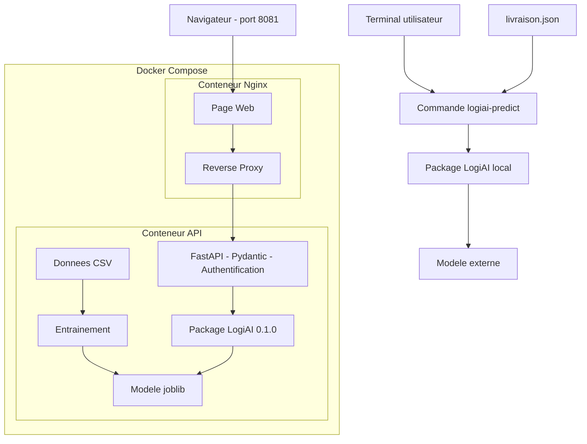

# Etude de conception - LogiAI

## 1. Besoin

## 2. Donnees

## 3. Modele et metriques

## 4. Criteres d'acceptation

## 5. Cycle de vie

## 6. Architecture

LogiAI repose sur une architecture modulaire separant le code,
les donnees, le modele et les interfaces utilisateur.

Le package est installe dans site-packages.
Le modele et les donnees restent externes au package.
LOGIAI_HOME permet de localiser ces ressources.
FastAPI assure la prediction, la validation et la securite.
Nginx heberge la page web et transmet les requetes a FastAPI.
Le port 8081 remplace le port 8080 occupe par Oracle Database.
La CLI permet de realiser une prediction sans serveur API.

## 7. Choix technologiques

## 8. Risques et ethique

## 9. Limites
